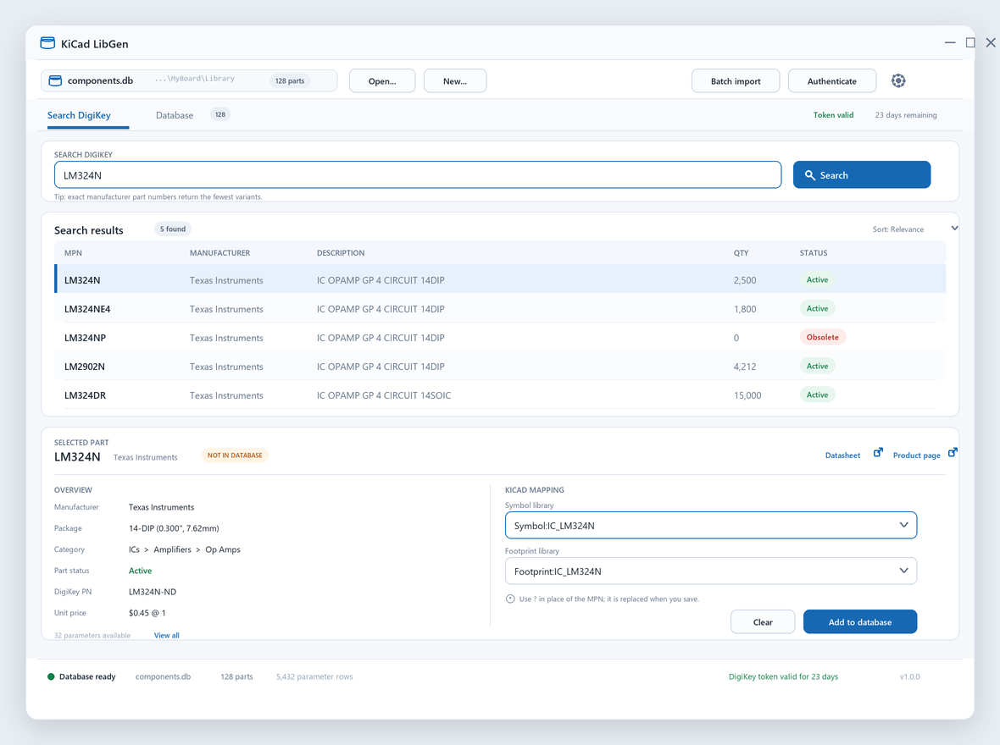
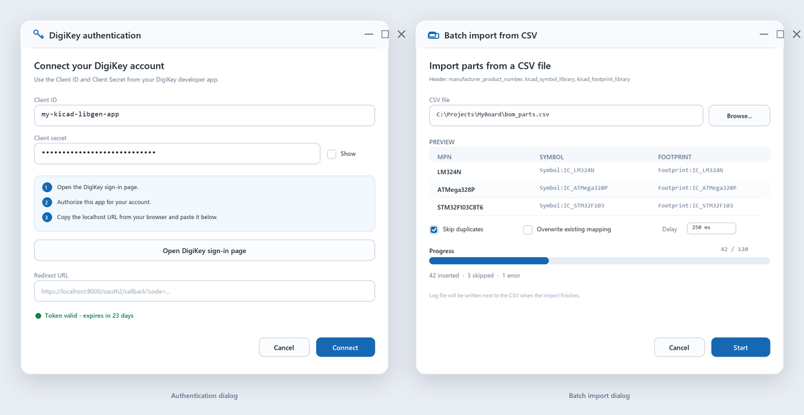

# KiCad LibGen GUI — Development Plan

**Status:** Draft for review · **Date:** 2026-11-03
**Source project:** [`last-sociable-orange/kicad_lib_gen`](https://github.com/last-sociable-orange/kicad_lib_gen) (pinned at commit `64ca2a9`)
**Target:** Windows 10/11 x64 and Linux desktop; standalone binaries with no Python or installer required.

---

## 1. Summary

Build a small native desktop front end around the existing `kicad_lib_gen` Python tool. The GUI keeps the current DigiKey OAuth token flow and SQLite schema, and adds the workflows that are awkward from a terminal:

- Search DigiKey, browse results, and see full part details.
- Link a part to a KiCad symbol and footprint, then insert it into `components.db`.
- Import a BOM-style CSV in batch, with progress, cancellation, and a log.
- Open or create the database, and optionally browse/edit existing mappings.

**Proposed stack:** Python 3.13 + Tkinter/ttk (stdlib) + PyInstaller one-file packaging. No GUI framework download, no Electron, no local web server.

| Requirement | Proposed solution |
|---|---|
| Runs on Windows and Linux | Tkinter/ttk is bundled with CPython on both; build a native artifact on each OS with PyInstaller (it cannot cross-compile) |
| Standalone, no installation | PyInstaller `--onefile` bundle contains CPython, Tcl/Tk, `requests`, `requests-oauthlib`, and CA certificates. User receives one executable per platform |
| Simple and small | One main window, two tabs, a few dialogs; no third-party UI toolkit; estimated 15–25 MB per platform and 1–3 s cold start (to be measured in Phase 0) |
| Stays compatible with KiCad | No schema changes; reuse the existing `components` table, `ID` key, and `32 × (Param, Value)` columns |

I recommend developing this as a fork of the upstream repository, with the GUI as an additional entry point. The CLI remains usable and the shared parsing/database code is fixed once.

**Non-goals for v1**

- Not a KiCad plugin and not a symbol/footprint editor; it manages the SQLite part database only.
- No CIS approval workflow, user accounts, or multi-user/server mode.
- No cloud sync or automatic updates.
- No macOS build (the architecture allows one later; it is not in scope).
- No automatic schema migration or bulk cleanup of existing databases.
- No dark theme or localization in v1.

---

## 2. What exists today

The upstream repository is four Python modules plus a sample database configuration:

| File | Role | Reusable by GUI? |
|---|---|---|
| `kicad_cip.py` | CLI workflow, `ProductInfo` models, `ProductDb`, response parsing | Yes, after extracting non-interactive parts |
| `digikey_search.py` | `digikey_search(keywords, token_file)` HTTP call and token refresh | Yes |
| `digikey_auth.py` | OAuth2 authorization-code flow, token refresh, saves `.token` | Yes, after splitting out `input()`/`print()` |
| `colors.py` | ANSI terminal output | No |
| `example_components_db.dbl` | Example KiCad database-library config | Reference for schema |

### Findings that affect the GUI

1. **Overwrite is currently broken on newly created databases.** `create_tbl()` defines no `UNIQUE` constraint and no primary key, but `insert_record()` uses `INSERT OR REPLACE`. Without a uniqueness conflict, SQLite performs a plain insert, so re-adding an MPN can create duplicate rows. The GUI will use an explicit `UPDATE`-then-`INSERT` upsert in one transaction, without changing the schema.
2. **The top-of-file schema comment is stale.** The executed schema has `ID` and `QtyAvailable`, while the comment block shows `Categories`/no `ID`. The GUI and tests will target the actual columns created by `create_tbl()`.
3. **`requests.post()` has no timeout.** A stalled DigiKey call would freeze a GUI worker indefinitely. Add a configurable timeout (default 30 s) and map timeouts to a friendly error.
4. **Response parsing assumes every key exists.** Partial or changed API responses can raise `KeyError`. The shared parser will use defensive `.get()` access and keep the existing fields when data is missing.
5. **Auth is interactive by design.** `get_auth_code()` calls `input()`, so the GUI needs non-interactive helpers for building the authorization URL, exchanging the code, and persisting tokens.
6. **Batch mode has no pacing or backoff.** DigiKey enforces rate limits. The GUI batch runner will add a configurable delay and exponential backoff on HTTP 429.

These are small, contained changes to a shared core module. They improve the CLI too.

---

## 3. Technology decision

### 3.1 GUI toolkit comparison

| Option | One-file size (est.) | Cold start | Cross-platform | Assessment |
|---|---:|---:|---|---|
| **Tkinter/ttk** | **15–25 MB** | **1–3 s** | Windows, Linux (bundled) | **Recommended.** Zero extra framework, stable, sufficient for forms/tables; native-ish on Windows with the `vista` ttk theme |
| PySide6 | 80–150 MB | 2–5 s | Excellent | Too large for the "small" requirement |
| pywebview | 10–20 MB + system WebView | 1–2 s | Fragile on Linux | Linux targets often lack WebKitGTK; not truly self-contained |
| Electron / local web app | 80–150 MB or browser | 2–5 s | Good | Overkill; violates "small" and "standalone app" spirit |

Tkinter's weakness is visual polish, not capability. The mockups in §5 show the intended layout; a small custom ttk style layer (colors, row height, typography, spacing) closes most of the gap. I will not attempt a pixel-perfect custom-drawn window.

### 3.2 Packaging

- **PyInstaller 6.22.x**, `--onefile --windowed`, pinned in `requirements-build.txt`. Current PyInstaller supports Python 3.13 and Tkinter, including the newer dynamic Tcl/Tk builds from python-build-standalone ([PyInstaller issue #9204](https://github.com/pyinstaller/pyinstaller/issues/9204)).
- **Build on each target OS.** PyInstaller is not a cross-compiler. CI uses `windows-latest` and `ubuntu-22.04`.
- **Two artifacts per release:**
  - `KiCadLibGen-<version>-win64.exe` (primary, one file).
  - `kicad-lib-gen-<version>-linux-x86_64.tar.gz` (primary, one file inside; tar preserves the executable bit).
  - Optional fallback if one-file startup or antivirus behavior is a problem: `--onedir` ZIPs, still no installer.
- **Size/startup target:** ≤ 30 MB compressed one-file and ≤ 3 s cold start on a typical machine. Phase 0 measures real numbers before the UI work starts. If the target is missed, the fallback is `--onedir` (faster start, larger folder), not a different toolkit.

### 3.3 Python version and Tk availability

- Use **Python 3.13**, matching upstream's `requires-python = ">=3.13"`.
- Windows: official CPython 3.13 x64 installer includes Tcl/Tk 8.6.
- Linux: use `uv python install 3.13` (python-build-standalone now ships dynamic Tcl/Tk and statically links X11 libraries) or, on Ubuntu, `deadsnakes` + `python3.13-tk`. Phase 0 verifies that the chosen build's Tk imports correctly before packaging.
- The GUI does not import `prompt_toolkit`; PyInstaller will exclude it from the GUI bundle. The CLI still uses it for source-based runs.

---

## 4. Architecture

### 4.1 Process and threading model

```
┌────────────────────────────── GUI process ──────────────────────────────┐
│  gui_main.py                                                            │
│   └─ gui/app.py            Tk root, theme, settings, global error hook  │
│       ├─ gui/main_window.py   Search tab, Database tab, status bar      │
│       ├─ gui/dialogs/         Auth, Batch, Settings, About              │
│       └─ gui/widgets/         ResultsTable, DetailPanel, ParamTable     │
│                                                                         │
│  services/                 UI-free, unit-testable                       │
│   ├─ auth_service.py       token load/refresh/save, OAuth code exchange │
│   ├─ search_service.py     search, parse, error mapping                 │
│   ├─ database_service.py   open/create/validate, upsert, query, update  │
│   └─ batch_service.py      CSV validation, import loop, log, backoff    │
│                                                                         │
│  kicad_core/               extracted from upstream, no prompts/ANSI     │
│   ├─ models.py             ProductInfoBase, ProductInfo                 │
│   ├─ parser.py             parse_digikey_response, parse_categories     │
│   └─ database.py           ProductDb/schema, fixed upsert, SQL params   │
└─────────────────────────────────────────────────────────────────────────┘
          │ HTTPS: OAuth2 + ProductSearch
          ▼
   api.digikey.com
          │
          ▼
   components.db (SQLite; existing KiCad schema)
```

- **All network calls and batch imports run on worker threads.** Tk is not thread-safe, so workers only put events on a `queue.Queue`; the Tk main loop drains it with `root.after(50, ...)` and updates widgets.
- **One short-lived SQLite connection per operation** (or one connection per worker), with `timeout=5`. This avoids `check_same_thread` hazards and keeps the DB usable while a search runs.
- **A single `TaskRunner`** owns a `ThreadPoolExecutor(max_workers=3)`, a busy flag, and a `threading.Event` for cancellation. Search and batch are mutually exclusive in the UI.
- **No shared mutable UI state in services.** Services receive plain dataclasses and return results; this keeps unit tests independent of Tk.

### 4.2 Proposed repository layout

```
kicad_lib_gen/                   # fork of upstream
├── digikey_auth.py              # CLI + importable auth helpers (refactored)
├── digikey_search.py            # CLI + timeout-aware search (kept compatible)
├── kicad_cip.py                 # CLI only; imports shared kicad_core
├── kicad_core/
│   ├── __init__.py
│   ├── models.py
│   ├── parser.py
│   └── database.py
├── gui_main.py                  # GUI entry point
├── gui/
│   ├── app.py
│   ├── theme.py
│   ├── main_window.py
│   ├── dialogs/
│   ├── widgets/
│   └── worker.py
├── services/
│   ├── auth_service.py
│   ├── search_service.py
│   ├── database_service.py
│   └── batch_service.py
├── assets/                      # app icon, 16 px toolbar icons
├── tests/
│   ├── fixtures/                # recorded DigiKey JSON, sample CSVs, temp DBs
│   ├── test_auth.py
│   ├── test_parser.py
│   ├── test_database.py
│   ├── test_batch.py
│   └── test_gui_smoke.py
├── build/
│   ├── kicad_lib_gen_gui.spec
│   ├── version_info.txt
│   ├── build_windows.ps1
│   └── build_linux.sh
├── .github/workflows/build.yml
├── pyproject.toml
├── requirements-build.txt
└── README-GUI.md
```

A separate repository is also possible, but it would either duplicate `ProductDb`/parser logic or require a submodule plus patches. A fork avoids both and lets us fix the upstream upsert bug once. If you prefer to keep this `KicadLibGui` folder as the only repository, the same package layout works; only `kicad_core/` would be a small vendored/refactored copy of upstream.

---

## 5. GUI design

### 5.1 Main window



*Visual mockup, not a screenshot of a finished build. The real app uses native ttk widgets and the OS window frame; spacing and colors will be close, pixel details will differ.*

**Layout**

- **Toolbar:** current database chip (filename, folder, record count), `Open…`, `New…`; right side `Batch import`, `Authenticate`, settings gear.
- **Tabs:** `Search DigiKey` and `Database` (with record-count badge). Token status is shown on the right of the tab strip.
- **Search panel:** single search field, prominent Search button, short hint. Enter triggers search.
- **Results table:** MPN, manufacturer, description, quantity, status. Status uses colored text/pills; selected row has an accent bar. Sorting by column is a stretch goal; default is DigiKey relevance.
- **Selected-part panel:**
  - Read-only overview: manufacturer, package, category, status, DigiKey part number, unit price, plus links to datasheet/product page.
  - Editable KiCad mapping: symbol library and footprint library comboboxes, with suggestions from existing DB values and `Symbol:?` / `Footprint:?` helpers.
  - Primary action: `Add to database`, or `Update database` when the MPN already exists. Secondary `Clear`.
  - `?` in either mapping field is replaced with the selected MPN at save time.
- **Status bar:** database ready/error state, DB filename, record count, token validity, version.

The default window is 1120 × 820; minimum 900 × 620. It is resizable; the results/detail split uses a vertical `ttk.PanedWindow`.

### 5.2 Dialogs



**DigiKey authentication**

- Client ID and Client secret fields (secret masked, optional Show).
- Clear three-step explanation: open sign-in page → authorize → copy the `localhost:8000` URL back into the dialog.
- `Open DigiKey sign-in page` uses the system browser. The browser will show a connection error at `https://localhost:8000/oauth2/callback?code=...`; the user copies that URL from the address bar and pastes it. The app parses and validates the `code` and `state` (when present).
- Shows token state after success (`expires in N days`).
- This matches the existing CLI flow and does not require a registered local HTTPS server. A silent local callback listener was considered and rejected for v1: the redirect URI is HTTPS, so it needs a self-signed certificate and browser trust exceptions.

**Batch import**

- CSV file picker, header validation, preview of the first rows.
- Options: `Skip duplicates` (default on), `Overwrite existing mapping` (off), request delay (default 250 ms).
- Progress bar with `n / total`, running counts, Cancel. Cancelling stops after the in-flight request.
- Summary with inserted/skipped/error counts and a button to open the log file. The log format stays compatible with the CLI: `<mpn>: <record> ==> <status>`.

**Settings** (small, non-modal or modal): database path, token path, search result limit, HTTP timeout, batch delay, log level, "Reveal config folder", "Clear authentication". Recent databases list in the File menu.

### 5.3 Key interactions

| Action | Behaviour |
|---|---|
| First launch, no database | Empty state in both tabs with `Open database…` and `Create database…`; last-used DB is reopened automatically if present |
| Search with no/expired token | Auth dialog opens; after success the original search is retried automatically |
| Search empty | Focus the field; do not call the API |
| Select result | Populate detail panel; if MPN exists in DB, show `In database` badge and prefill existing symbol/footprint; button becomes `Update database` |
| Save new part | Validate mapping, replace `?`, confirm, upsert, refresh count, show non-blocking success toast |
| Save existing part | Confirm overwrite, update exactly one logical record; report if legacy duplicates were also updated |
| `?` placeholder | Replaced with `ManufacturerProductNumber` before validation and save |
| Open datasheet/product | `webbrowser.open()` after an `http`/`https` scheme check |
| Batch import | Worker thread; UI stays responsive; cancel sets an event checked between rows |
| Errors | Inline banner for auth/network errors with `Details`; modal only for destructive confirmations |
| Keyboard | `Ctrl+O` open DB, `Ctrl+N` new DB, `Ctrl+B` batch, `Ctrl+F`/`Ctrl+L` search, `Enter` search, `Ctrl+S` save, `F5` refresh DB, `Esc` cancel/close dialog |

### 5.4 Visual system

- Light theme only in v1. Accent: KiCad-ish blue `#1668b3`; neutral background `#f5f7fb`; white cards with `#dee5ef` borders.
- Font: Segoe UI on Windows, DejaVu Sans/Noto Sans on Linux; use Tk named fonts and scale for DPI. Per-monitor DPI awareness on Windows (`SetProcessDpiAwarenessContext` with fallback).
- ttk theme: `vista` on Windows, `clam` on Linux. Custom styles: `Accent.TButton`, `Card.TFrame`, `Treeview` row height/padding, `Status.TLabel`.
- 16 px PNG toolbar icons generated from simple vector shapes; no icon font dependency.
- The actual window uses the OS title bar; the mockup's custom-looking title area is illustrative only.

---

## 6. Functional specification

### 6.1 Configuration and paths

| Item | Windows | Linux |
|---|---|---|
| Settings | `%APPDATA%\KiCadLibGen\settings.json` | `${XDG_CONFIG_HOME:-~/.config}/kicad-lib-gen/settings.json` |
| Token | same directory, `token.json` (default; configurable) | same |
| Logs | `%LOCALAPPDATA%\KiCadLibGen\logs\app.log` | `${XDG_STATE_HOME:-~/.local/state}/kicad-lib-gen/logs/app.log` |
| Portable mode | `portable.txt` next to the exe or `--portable`, then use `data\` next to the exe | same |

The token file keeps the exact upstream JSON structure (`client_id`, `client_secret`, `access_token`, `refresh_token`, `expires_by`, `refresh_token_expires_by`) so existing `.token` files can be imported. On first run, if a `.token` file exists beside the executable or in the working directory, the app offers to import it; the token path is also configurable in Settings. On POSIX, create the file with mode `0600`. Never log tokens or client secrets.

### 6.2 Authentication

- Refactor `digikey_auth.py` into reusable functions:
  - `build_authorization_url(client_id, redirect_uri, state) -> str`
  - `exchange_code(client_id, client_secret, code, redirect_uri) -> token dict`
  - `refresh_access_token(...)` (existing, kept)
  - `load_token(path)`, `save_token(path, token)`, `token_status(token)`.
- `ensure_token(path)`:
  - Load token; if access token expires in > 30 s, return it.
  - If refresh token is valid, refresh and atomically rewrite the file (temp file + `os.replace`), guarded by a process lock.
  - Otherwise raise `AuthRequired`.
- On HTTP 401 during search: refresh once and retry once; if it still fails, open the auth dialog.
- Add and validate OAuth `state` to prevent CSRF; accept a pasted URL with or without the state parameter, but reject a mismatch.
- Token refresh writes are atomic; a crash must not truncate the token file.

### 6.3 Search

- `search_service.search(keywords, limit=25, offset=0)` calls `digikey_search.py` (modified to accept `timeout`).
- Parsing uses the shared `parse_digikey_response`; missing optional fields become empty strings, not exceptions.
- Result limit configurable (10/25/50); optional `Load more` using `offset` in v1.1.
- Error mapping:

| Condition | User-facing message |
|---|---|
| 401 | "DigiKey session expired. Sign in again." → auth dialog |
| 403 | "This DigiKey app is not authorized for ProductSearch. Check the app's API scopes." |
| 429 | "DigiKey rate limit reached. Wait N seconds and retry." |
| 5xx | "DigiKey is temporarily unavailable. Retry in a moment." |
| timeout / connection | "Could not reach DigiKey. Check your network or proxy." |
| invalid JSON | "DigiKey returned an unexpected response." + details/log |

- Do not retry non-401 errors automatically except a single backoff for 429/5xx in batch mode.

### 6.4 Database

- `database_service` wraps the existing `ProductDb` and adds:
  - `open_or_create(path)`, `validate_schema(path)`, `count()`
  - `find_by_mpn(mpn)`, `list_records(filter, limit)`, `distinct_symbols()`, `distinct_footprints()`
  - `upsert(product)`, `update_mapping(mpn, symbol, footprint)`, `delete(mpn)`
  - `duplicate_mpns()`
- **Schema stays unchanged.** Opening an unknown/partially migrated DB shows a clear error, never silently alters it. Existing `components.db` files from the CLI must work as-is.
- **Upsert logic:** within `BEGIN IMMEDIATE`, `UPDATE components SET ... WHERE ManufacturerProductNumber = ?`; if `rowcount == 0`, `INSERT`. All 80 columns are written. This fixes duplicate insertion without relying on a constraint that does not exist.
- Existing duplicates are reported in the Database tab (`Duplicate MPNs: N`) but not deleted automatically. A future "repair" action can be added after review.
- Save validation: symbol and footprint are required for GUI saves (the CLI allowed empty strings). Trim whitespace; reject newlines. If the user wants metadata-only records, a `Save without mapping` secondary action can be added later.
- SQLite `database is locked` maps to: "The database is in use (KiCad or another app). Close it and retry." Avoid WAL mode changes so KiCad's ODBC access is unaffected.

### 6.5 Batch import

- Accept the upstream CSV format: header + exactly 3 columns in order: `manufacturer_product_number,kicad_symbol_library,kicad_footprint_library`. UTF-8 with BOM is accepted.
- Preview validates every row and shows line-specific errors before starting.
- Per row: search, require exactly one product (strict, matching upstream), skip duplicates by default, set mapping from CSV, upsert.
- Delay between requests (default 250 ms, configurable). On 429, wait 2/4/8 s and retry up to 3 times; on repeated failure, stop with an actionable error while preserving completed rows.
- Write `<csv_basename>-<timestamp>.log` next to the CSV using the upstream line format. Also show a summary and offer `Open log`.
- Cancellation after the current row; log statuses for remaining rows as `cancelled`.
- Never run batch on the Tk thread.

---

## 7. Packaging and delivery

### 7.1 Build pipeline

| Platform | Runner | Python | Artifact |
|---|---|---|---|
| Windows x64 | `windows-latest` | CPython 3.13 x64 (official installer) | `KiCadLibGen-<ver>-win64.exe` + SHA256 |
| Linux x86_64 | `ubuntu-22.04` | Python 3.13 via `uv` or deadsnakes, Tk enabled | `kicad-lib-gen-<ver>-linux-x86_64.tar.gz` + SHA256 |

- One GitHub Actions workflow builds both on tag `v*` and on pull requests (PR builds upload artifacts without publishing).
- Build scripts are runnable locally: `build\build_windows.ps1`, `build/build_linux.sh`.
- Smoke test in CI: run the binary with `--self-test`, which imports all modules, creates a temp SQLite DB, runs an upsert round-trip, and exits 0. On Linux, also launch under `xvfb-run` and close after 2 s.
- Add `--version`, `--self-test`, and `--portable` command-line flags.

### 7.2 Platform notes

**Windows**
- Target Windows 10 1809+ and Windows 11, x64. Bundle the VC runtime as PyInstaller does by default.
- Unsigned one-file executables may trigger SmartScreen and occasional antivirus false positives. Document this; code signing with an Authenticode certificate is optional and requires a certificate from you.
- One-file startup extracts to `%TEMP%`; if corporate policy blocks that, ship the onedir fallback.

**Linux**
- Build on Ubuntu 22.04 as a conservative baseline. Phase 0 records the actual minimum glibc with `objdump`; the supported/tested matrix starts at Ubuntu 22.04/24.04, Debian 12, and Fedora 40+ (X11 and Wayland via XWayland). Older glibc distros would need a separate build container; call that out if you need RHEL 8/CentOS 7.
- Tk still needs the platform GUI stack (X11/XWayland and font libraries) at runtime; every normal desktop has it. A headless server does not.
- One-file extracts to `/tmp`; systems with `noexec` on `/tmp` need the onedir fallback.
- Distribute `.tar.gz` so the executable bit survives. Include a one-line `chmod +x` note in the README.

**Both**
- No installer, no registry changes, no background service. Uninstalling = delete the executable and optionally the config folder.
- Configuration is per-user by default; portable mode keeps everything beside the executable.
- Avoid placing the live `components.db` in a OneDrive/Dropbox-synced folder (including this workspace). Sync clients can lock or corrupt SQLite files. The GUI will warn when the selected DB path is under a known sync folder and recommend a local `Library` folder.
- Licensing: upstream and the GUI code are MIT. PyInstaller is GPLv2-or-later with a special exception that permits bundling non-GPL applications; Tkinter is PSF-licensed. Ship the upstream `LICENSE` and a short third-party notices file with each release.

---

## 8. Implementation phases and estimates

Estimates are ideal development days for one developer, excluding review latency.

| Phase | Scope | Days | Exit criteria |
|---|---|---:|---|
| **0. Feasibility spike** | Fork/pin upstream; run CLI; build a "hello Tk" one-file on Windows and Linux; measure size/startup; verify Tk in the build Python; test OAuth paste flow with a real DigiKey app | 0.5 | Measured bundle ≤ 30 MB and startup ≤ 3 s; Go/No-Go on Tkinter; screenshot of real Tk build reviewed |
| **1. Core extraction and services** | `kicad_core` (models/parser/database), auth helpers, timeout, explicit upsert, parameterized SQL; unit tests; CLI regression | 2 | Unit tests pass; `kicad_cip.py` single and batch CLI still work against a temp DB; no duplicate on re-add |
| **2. Main window MVP** | App shell, theme, settings/logging, toolbar/tabs/status, search flow, results table, detail panel, mapping combos, add/update, open/create DB, auth dialog, worker queue, error banners | 3 | End-to-end search → map → save → reopen with a real token; UI responsive; auth required/expired flows work |
| **3. Batch import** | CSV validation/preview, worker import, progress, cancel, rate limit/backoff, log and summary | 1.5 | 50-row mixed CSV produces correct counts; cancel works; log matches upstream format; 429 handling verified with a mock |
| **4. Database tab** *(recommended)* | Browse/filter records, edit mapping, duplicate report, delete with confirmation | 1.5 | Edits persist; duplicate MPNs flagged; delete only after confirmation; no schema change |
| **5. Packaging, CI, QA, docs** | Icons, PyInstaller spec, local build scripts, GitHub Actions, clean-VM tests, README/quick start/troubleshooting, checksums | 2 | Signed-off release artifacts run on clean Windows and Ubuntu without Python; docs reviewed |
| **Total** |  | **10.5 days** | MVP without Phase 4: ~9 days. Add ~20% buffer for review/API surprises → plan ~12–13 calendar working days |

**Review checkpoints:** after Phase 0 (measured bundle + real Tk screenshot) and after Phase 2 (working search/save flow) before investing in batch and DB browsing.

**Suggested MVP cut:** Phases 0–3 + 5. The Database tab can ship as v1.1 if "simple and small" is the priority.

---

## 9. Testing and quality

### 9.1 Automated tests

| Area | Cases |
|---|---|
| Parser | Full fixture; missing `QuantityAvailable`; >32 parameters truncated; resistor value override; datasheet URL normalization |
| Auth | Token load/save; refresh when < 30 s; expired refresh token → `AuthRequired`; atomic write; OAuth state mismatch; code extraction from pasted URL |
| Database | Create schema; open CLI-created DB; insert; update; re-add same MPN does **not** duplicate; duplicate detection; parameterized MPN with quotes; locked DB error |
| Search service | 401 → refresh once; 403/429/timeout/5xx mappings; malformed JSON; empty keywords |
| Batch | Header validation; 3 columns; BOM; blank lines; 0/1/many results; skip duplicate; overwrite; cancel; log content |
| Config | Windows/Linux paths (monkeypatched); portable mode; missing settings fallback |
| GUI smoke | Construct root under Xvfb; switch tabs; inject a fake result; save to temp DB; close; assert no orphan threads |

HTTP is mocked with `responses`/`requests-mock`; no real DigiKey calls in CI. A manual integration test with a real developer account is performed in Phase 2 and before release.

### 9.2 Manual test matrix

- Windows 10 and 11, 100% and 150% DPI, standard user (not admin).
- Ubuntu 22.04 and 24.04, X11 and Wayland sessions.
- Clean VM with no Python installed.
- Paths with spaces, non-ASCII characters, and a read-only database folder.
- No network; slow network; 401/403/429 simulated; expired token.
- New DB, CLI-created DB, DB with pre-existing duplicate MPNs, DB open in KiCad (locked).
- CSV: 0 rows, 1 row, 100 rows, malformed header, CRLF/LF, BOM, quoted fields.
- Batch cancel mid-run; close app during search.
- Sleep/resume and monitor DPI change while running.

### 9.3 Acceptance criteria

1. On a clean Windows 10/11 x64 and Ubuntu 22.04/24.04 machine with no Python, the downloaded executable launches by double-click/`./` and shows the main window.
2. A user can authenticate, search an MPN, select a result, set symbol/footprint, and save; the row appears in `components.db` with the existing schema and opens correctly in KiCad's database library.
3. Re-adding an existing MPN updates it and does **not** create a duplicate row.
4. A 100-row CSV import completes with a log and summary; cancellation works; one bad row does not crash the app.
5. Authentication expiry and network errors produce actionable messages, not tracebacks or frozen UI.
6. The UI remains responsive during search and batch import; all Tk updates occur on the main thread.
7. The existing CLI (`uv run kicad_cip.py -k ...`, `-b ...`) still behaves as before.
8. One-file artifact ≤ 30 MB and cold start ≤ 3 s on the reference machines; actual numbers documented.
9. No tokens or client secrets appear in logs, crash dialogs, or error details.
10. README covers install-free usage, first-run authentication, DB location, Linux permissions, and known limitations.

---

## 10. Risks and mitigations

| Risk | Impact | Mitigation |
|---|---|---|
| OAuth redirect UX (copy/paste, browser connection error) confuses users | High | Clear three-step dialog with "Open sign-in page"; auto-parse the pasted URL; test with a real app; document with screenshots |
| DigiKey API changes or rate limits | Medium | Isolate API in `search_service`; defensive parser; 429 backoff; manual integration test before release |
| Tkinter looks dated or inconsistent across OSes | Medium | Custom ttk styles, native theme selection, DPI scaling; approve mockups before implementation; accept native differences |
| PyInstaller one-file startup / antivirus false positives | Medium | Measure in Phase 0; publish SHA256; optional onedir fallback and code signing; document |
| Linux glibc/Tk compatibility | Medium | Build on Ubuntu 22.04, test on 22.04/24.04 + Debian/Fedora; pin Python; document minimum glibc; onedir fallback |
| Upstream code drift or merge conflicts | Medium | Pin upstream commit; keep core extraction small; add tests; rebase before release |
| Existing duplicate MPNs in DBs | Medium | Detect and report; do not auto-delete; upsert prevents new duplicates; optional repair tool later |
| SQLite DB on OneDrive/Dropbox | Medium | Warn on sync-folder paths; recommend local `Library` folder; never enable WAL |
| Token stored in plaintext | Medium | `0600` permissions on POSIX; never log secrets; optional OS keyring/DPAPI in v1.1, not v1 |
| Batch of hundreds of parts takes a long time | Low | Progress/cancel, configurable delay, resumable log; user can split CSVs |
| No code-signing certificate | Low | Document SmartScreen; provide checksums; signing can be added later |

---

## 11. Decisions I need from you

1. **Repository shape:** fork upstream and add the GUI (recommended), or keep this as a separate `KicadLibGui` repo with a vendored core? The fork avoids duplicate parser/DB code.
2. **Database tab in v1?** It adds ~1.5 days. I recommend including browse/edit mapping and duplicate reporting; delete can be deferred.
3. **Token storage:** plaintext token file with `0600` (upstream parity, recommended for v1), or invest in Windows DPAPI / Linux Secret Service now? The latter adds platform complexity and another failure mode.
4. **Code signing:** do you have an Authenticode certificate? If not, ship unsigned with SHA256 and a SmartScreen note.
5. **Linux target range:** Ubuntu 22.04+ only (recommended), or must it also run on RHEL 8/CentOS 7-era glibc? The latter requires an older build container.
6. **Branding/name:** `KiCad LibGen` with subtitle "Component Database Manager", or a different product name?
7. **Merge upstream:** should the GUI live in the upstream repo permanently, or in a personal fork that periodically rebases?

If you approve the defaults (fork, Tkinter, one-file PyInstaller, DB tab included, plaintext token, Ubuntu 22.04+), I can start with Phase 0 and show you the measured bundle plus a real Tk screenshot before building the full UI.

---

## Appendix A — Database schema the GUI must preserve

The active `create_tbl()` creates table `components` with 80 columns:

- 16 metadata columns: `ID`, `Description`, `Keywords`, `Value`, `Manufacturer`, `ManufacturerProductNumber`, `Package`, `KicadSymbolLibrary`, `KicadFootprintLibrary`, `PartStatus`, `QtyAvailable`, `Distributor`, `DistributorProductNumber`, `UnitPrice`, `ProductUrl`, `DatasheetUrl`.
- 64 parametric columns: `Param01`/`Value01` … `Param32`/`Value32`.

`example_components_db.dbl` uses `"table": "components"`, `"key": "ID"`, and `KicadSymbolLibrary` / `KicadFootprintLibrary` for symbol and footprint lookup. The GUI will not rename, add, or drop columns. The upstream top-of-file schema comment is stale and will be corrected to match the actual DDL.

## Appendix B — References

- [Upstream repository](https://github.com/last-sociable-orange/kicad_lib_gen)
- [PyInstaller on PyPI](https://pypi.org/project/pyinstaller/) (Python 3.8–3.15 support; one-file bundling; no cross-compilation)
- [PyInstaller issue #9204 — python-build-standalone dynamic Tkinter/Tcl/Tk](https://github.com/pyinstaller/pyinstaller/issues/9204)
- [python-build-standalone](https://github.com/astral-sh/python-build-standalone)
- [DigiKey Developer Portal](https://developer.digikey.com/)
- [KiCad documentation — database libraries](https://docs.kicad.org/)
