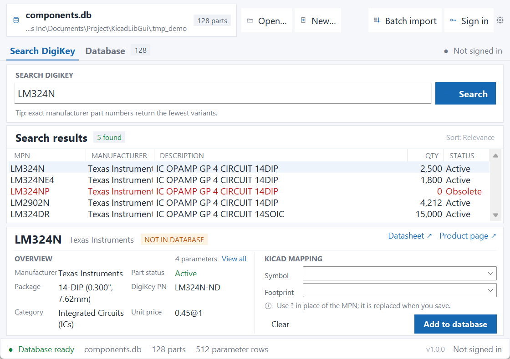
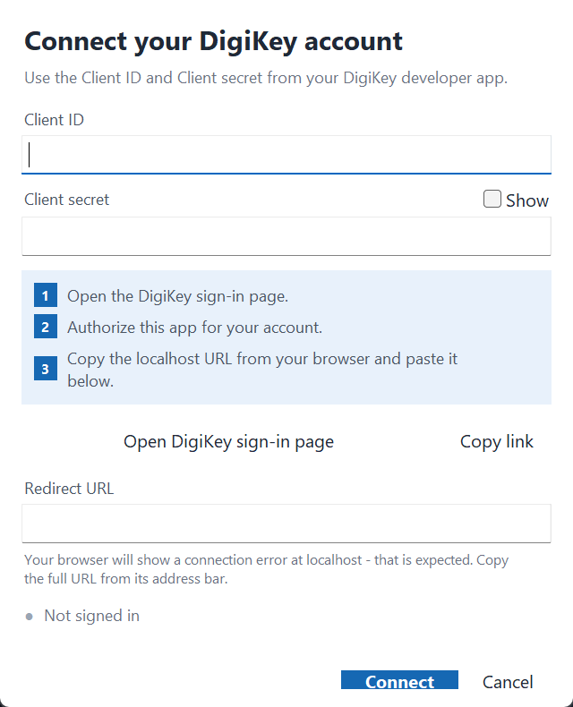
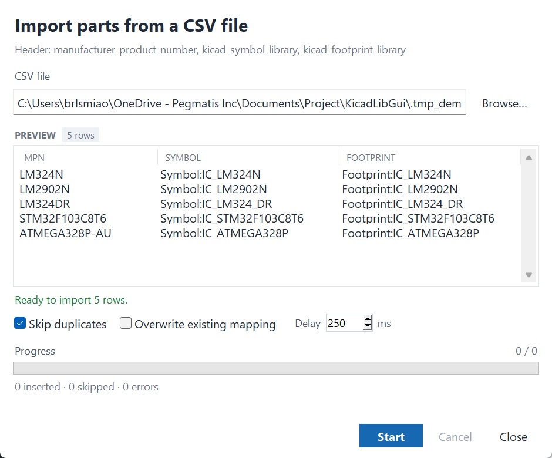
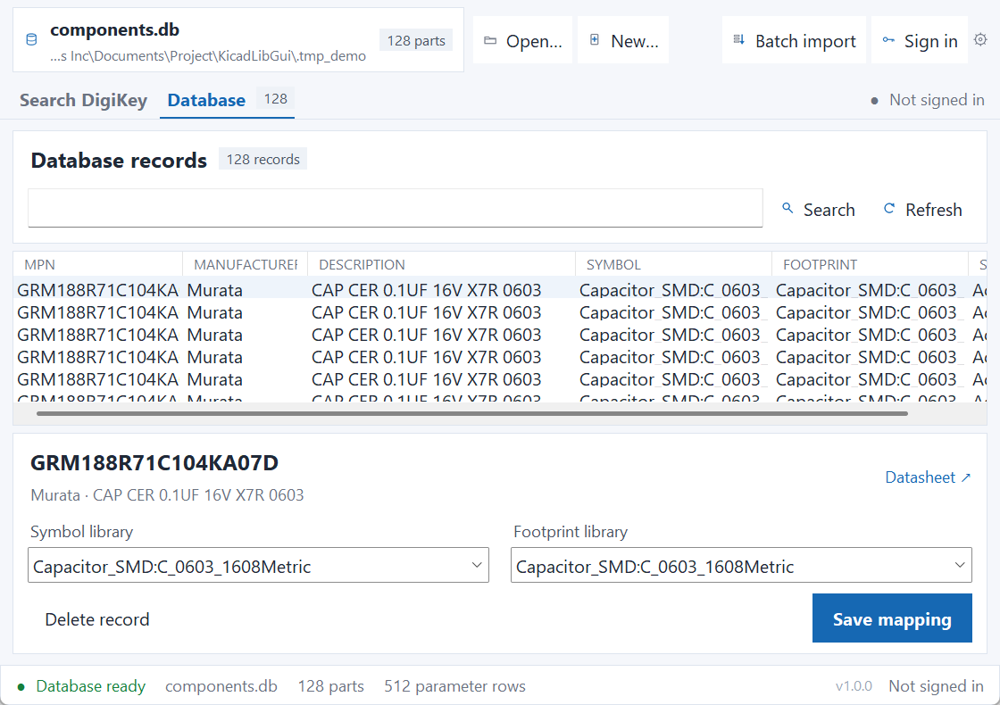

# KiCad LibGen GUI

**Component Database Manager** — a small native desktop front end for
[`last-sociable-orange/kicad_lib_gen`](https://github.com/last-sociable-orange/kicad_lib_gen)
(pinned at commit `64ca2a9`).

Search DigiKey, map a part to a KiCad symbol and footprint, and save it into
the existing `components.db` schema.  The command-line tool keeps working;
both entry points share one core implementation.



## What it does

- **Search DigiKey** with the existing OAuth token flow, browse results and
  see full part details (manufacturer, package, category, status, pricing,
  datasheet and product links).
- **Save to `components.db`** with an explicit upsert that updates an existing
  MPN instead of creating a duplicate row.  The 80-column schema is unchanged.
- **Batch import** a 3-column CSV with preview, validation, progress,
  cancellation, 429 backoff and an upstream-compatible log file.
- **Browse and edit** existing records, filter them, report duplicate MPNs and
  delete a record after confirmation.
- **Run standalone**: no Python, no installer and no local web server are
  required for the released executable.

## Install-free usage

Download the artifact for your platform from the release page:

| Platform | Artifact | Run |
|---|---|---|
| Windows 10/11 x64 | `KiCadLibGen-1.0.0-win64.exe` | Double-click. SmartScreen may warn because the binary is unsigned; see *Known limitations*. |
| Windows 10/11 x64 (fallback) | `KiCadLibGen-1.0.0-win64-onedir.zip` | Extract and run `KiCadLibGenDir\KiCadLibGenDir.exe`. Faster start and no temp extraction. |
| Linux x86_64 | `kicad-lib-gen-1.0.0-linux-x86_64.tar.gz` | `tar xzf …`, then `chmod +x kicad-lib-gen-1.0.0-linux-x86_64` and `./kicad-lib-gen-1.0.0-linux-x86_64` |

No registry entries, services or background updates are created.  To uninstall,
delete the executable and (optionally) the configuration folder listed below.

### First launch

1. The app starts with no database open.  Click **New…** and choose a local
   path such as `~/KiCadLibGen/components.db` (Windows:
   `C:\Users\<you>\KiCadLibGen\components.db`).  A `.db` file is a normal
   SQLite database.
2. Click **Authenticate** and enter the Client ID and Client secret from your
   DigiKey developer app.  Follow the three steps in the dialog: open the
   sign-in page, authorize the app, then copy the `localhost:8000` URL from
   your browser's address bar into the dialog (the browser is expected to show
   a connection error there).
3. Search for a part, select a result, enter the KiCad symbol and footprint
   library names, and click **Add to database**.



### Where settings and tokens live

| Item | Windows | Linux |
|---|---|---|
| Settings | `%APPDATA%\KiCadLibGen\settings.json` | `${XDG_CONFIG_HOME:-~/.config}/kicad-lib-gen/settings.json` |
| Token | `%APPDATA%\KiCadLibGen\token.json` | `${XDG_CONFIG_HOME:-~/.config}/kicad-lib-gen/token.json` |
| Logs | `%LOCALAPPDATA%\KiCadLibGen\logs\app.log` | `${XDG_STATE_HOME:-~/.local/state}/kicad-lib-gen/logs/app.log` |

The token file keeps the exact upstream JSON structure, so an existing
`.token` file can be imported automatically when the app finds one beside the
executable or in the working directory.  On POSIX the file is created with
mode `0600`.  Tokens and client secrets are never written to the log.

**Portable mode:** pass `--portable` or create a file named `portable.txt`
next to the executable; settings, token and logs then live in `data\` beside
the executable.

**Do not keep a live database in OneDrive/Dropbox/Google Drive.**  Sync clients
can lock or corrupt SQLite files.  The app warns when the selected path is
inside a known sync folder and recommends a local `KiCadLibGen` folder.

## Using the GUI

- **Search** uses the configured result limit (10/25/50) and maps DigiKey
  errors to actionable messages: 401 opens sign-in, 403 explains API scopes,
  429 reports the retry delay, 5xx and timeouts explain the network problem.
- **KiCad mapping**: enter `Symbol:?` or `Footprint:?` to substitute the
  selected MPN at save time.  Suggestions come from existing database values.
- **Existing parts** are detected by MPN; the button changes to
  **Update database** and asks before overwriting.
- **Batch import** accepts UTF-8 (with or without BOM) and exactly this header:

  ```csv
  manufacturer_product_number,kicad_symbol_library,kicad_footprint_library
  LM324N,Symbol:IC_LM324N,Footprint:IC_LM324N
  ```

  The log is written next to the CSV as `<name>-<yy-mm-dd-HH-MM-SS>.log` with
  one line per part: `<mpn>: <record> ==> <status>`.
- **Keyboard shortcuts**: `Ctrl+O` open, `Ctrl+N` new database, `Ctrl+B` batch,
  `Ctrl+F`/`Ctrl+L` focus search, `Enter` search, `Ctrl+S` save, `F5` refresh,
  `Esc` dismiss the error banner.




## Command line

The upstream CLI remains available and now shares the fixed upsert, defensive
parser, timeout and non-interactive auth helpers:

```bash
uv run kicad_cip.py -k LM324N                 # interactive single part
uv run kicad_cip.py -b parts.csv -o components.db
uv run digikey_auth.py -u CLIENT_ID -s SECRET -o .token
uv run digikey_search.py LM324N --json
```

The batch log format is unchanged (`<mpn>: <record> ==> <status>`), and the
log is written next to the CSV rather than the working directory.  One bad row
is logged and the batch continues; the summary includes an error count.

## Development

Requirements: Python 3.13 (the official Windows build or
`uv python install 3.13`; Tk 8.6 must import), plus `uv` or pip.

```bash
python -m venv .venv
.venv\Scripts\activate            # Windows
# source .venv/bin/activate       # Linux
pip install -r requirements-dev.txt

python gui_main.py                # source run
python gui_main.py --self-test    # offline smoke check
python gui_main.py --smoke-test   # build the real window and close it
pytest                            # test suite
ruff check .                      # lint
```

### Layout

```
kicad_core/      models, defensive parser, SQLite access (fixed upsert)
services/        config, auth, search, database, batch, logging (no Tk)
gui/             app shell, theme, worker, widgets, dialogs, database tab
gui_main.py      entry point and --version/--self-test/--smoke-test
kicad_cip.py     CLI (shared core; prompt_toolkit only for interactive mode)
digikey_auth.py  OAuth2 helpers + CLI
digikey_search.py ProductSearch client + CLI
tests/           parser, auth, database, search, batch, config, CLI, GUI smoke
build/           PyInstaller spec, version resource, platform build scripts
.github/workflows/build.yml
```

### Build a one-file executable

PyInstaller cannot cross-compile: build on each target OS.

```powershell
# Windows (from the repo root)
.\build\build_windows.ps1
```

```bash
# Linux (from the repo root)
./build/build_linux.sh
```

Both scripts generate the icons, run the tests and `--self-test`, build with
the spec in `build/`, print size and startup measurements, and write a
SHA256 file.  Artifacts land in `dist/`.

The builds exclude `prompt_toolkit` (GUI) and test/lint tooling; Tkinter,
`requests` and CA certificates are included.  See
[`docs/IMPLEMENTATION-NOTES.md`](docs/IMPLEMENTATION-NOTES.md) for measured
one-file size and cold-start numbers on the build machine.

## Known limitations

- **Windows SmartScreen / antivirus**: one-file PyInstaller executables are
  often unsigned and may show an "unrecognized app" prompt or an occasional
  antivirus false positive.  Checksums are published with each release; code
  signing is not configured.
- **One-file startup** extracts to `%TEMP%` (Windows) or `/tmp` (Linux).  If
  policy blocks execution there, or if the one-file start is slow because of
  antivirus/OneDrive scanning, use the one-dir ZIP fallback.  On the
  development machine the one-dir build started in 1.5 s versus 7.2 s for
  the one-file build (13.0 MB); both meet the size target.  See
  [`docs/IMPLEMENTATION-NOTES.md`](docs/IMPLEMENTATION-NOTES.md).
- **Linux GUI stack**: Tk needs X11/XWayland and font libraries; a headless
  server without a desktop cannot show the window.  The release targets
  Ubuntu 22.04+/Debian 12/Fedora 40+; Ubuntu 22.04 is the build baseline.
- **OAuth redirect UX**: the browser shows a connection error at
  `https://localhost:8000/oauth2/callback`; copying that URL back into the app
  is intentional and matches the upstream flow.
- **Plaintext token file**: v1 stores the token in a `0600` JSON file.  OS
  keyring/DPAPI storage is deferred.
- **Duplicate MPNs** already present in a legacy database are reported but not
  deleted automatically.  New saves update the matching row(s) and never add
  another duplicate.
- **No macOS build** and **no dark theme/localization** in v1.
- The sample database from upstream is not bundled; create an empty database
  or open an existing KiCad one.

## Licence

MIT.  Upstream copyright and third-party notices are in `LICENSE` and
`THIRD-PARTY-NOTICES.md`.
